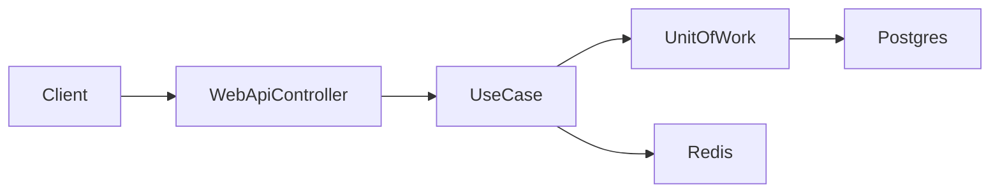

# Архитектура решения

Ограничения, которым следует реализация восьми эндпоинтов. Контракт маршрутов, полей и кодов — в [ЗАДАНИЕ.md](ЗАДАНИЕ.md). Факты уже написанного кода — в [.cursor/rules/PROJECT.md](.cursor/rules/PROJECT.md). Этот файл говорит, как класть новый код рядом с существующим и какие правила из контракта легко нарушить текущей заготовкой.

Заметку для сдачи («какие решения приняты и почему») этот документ не заменяет. Там, где ниже пункт назван открытым, в коде рядом стоит комментарий `// решение:` на одну-две строки, а в заметке сдачи — та же мысль.

## Слои

Новый код остаётся в текущих проектах. Имена проектов, их расположение, команды из [README.md](README.md), `docker-compose.yml` и строки подключения не меняются. Отдельный хост, MediatR, шина команд и слой CQRS не добавляются.

- HTTP, разбор запроса, коды ответа и сценарии — в `WebApi`. Контроллеры лежат рядом с [AuthController](WebApi/Controllers/AuthController.cs). Как разрезать восемь маршрутов по классам, контракт не задаёт: группировка по ресурсу (`enrollments`, `schedule`, `analytics`) совпадает с тем, как уже устроен `auth`.
- Сценарий, которому нужна транзакция, живёт в сервисе WebApi. Контроллер переводит результат сервиса в статус и тело. Сервис берёт `IUnitOfWork` и уже зарегистрированные `ICacheService` / `IConnectionMultiplexer`.
- Запросы, блокировки и новые методы репозиториев — в `DataAccessLayer`, на существующих репозиториях или рядом с ними. Новые сущности, конфигурации EF и миграции тоже там.
- `Common` уже содержит generic repository, unit of work и кэш. Туда попадает только то, что не знает про клуб.

`IUnitOfWork` сам транзакцию не открывает. Сценарий берёт `DbContext` у unit of work и открывает транзакцию на нём, затем вызывает `SaveChangesAsync` и фиксирует её. Репозитории и `SaveChangesAsync` обязаны видеть один и тот же контекст.

Пользователь новых маршрутов определяется из JWT через [BaseApiController](WebApi/Controllers/BaseApiController.cs): `CurrentUserId` и `IsAdmin`. Идентификатор в тело и в query не принимается. Логин, `AccessTokenService` и параметры JWT остаются как есть.

`Program` по-прежнему применяет миграции и сидер на старте. Класс `Program` остаётся `public partial`: на него опирается `WebApplicationFactory`.

## Контракт

Маршруты вызываются буквально, без префикса `/api` и без версии. Успешный ответ содержит ровно перечисленные поля. Неизвестные поля запроса игнорируются, отдельной ошибки на них нет. System.Text.Json уже так настроен, `UnmappedMemberHandling` не ужесточается.

Коды и значения `reason`, которые таблицы задания уже назвали, не переименовываются. Свой `reason` допустим только там, где контракт молчит; имя попадает в комментарий `// решение:` и в заметку сдачи.

Роль проверяется только на `GET /analytics/load`: нужна роль `admin`, иначе `403`. Остальные семь маршрутов доступны любому авторизованному пользователю. Фраза задания про «пять эндпоинтов» с таблицами кодов не сходится, ориентир — таблицы. Запрос без токена или с недействительным токеном по-прежнему заканчивается служебным `401`, его тело не подменяется.

Чужая бронь и чужая запись очереди для вызывающего — это `404`, как будто записи нет.

Отказ не меняет места и остаток посещений: проверка и запись идут в одной транзакции, при отказе она откатывается.

## Ошибки

Бизнес-ответы, которые формирует новый код, — `ProblemDetails`. Свой формат ошибки не вводится. Поле `reason` кладётся в `ProblemDetails.Extensions`: встроенный writer выносит его на верхний уровень, рядом со `status` и `title`.

Служебные ответы инфраструктуры остаются своими. К ним относятся отказ авторизации, неподдерживаемый тип содержимого и ответ [ExceptionHandlingMiddleware](WebApi/Middleware/ExceptionHandlingMiddleware.cs) на необработанное исключение. Middleware не учится разбирать бизнес-отказы: сценарий сам возвращает `Conflict`, `BadRequest`, `NotFound` или `Forbid` с `ProblemDetails`.

Нечисловое значение в пути — `400`. Ограничение маршрута `{id:long}` даёт на таком сегменте `404`, потому что маршрут не совпадает. Идентификатор в пути разбирается кодом сценария, ограничение `:long` на этих маршрутах не ставится. Число, которого нет в базе, — `404`. Нечисловое значение в теле, пустое тело и неразбираемый JSON там, где тело обязательно, — `400`.

## Время и даты

Все моменты — UTC, ISO 8601. Значение без смещения трактуется как UTC, значение со смещением приводится к UTC. `DateTimeKind.Unspecified` после привязки модели к UTC приводится явно.

Поля, которые задание называет датой, принимаются и отдаются как `yyyy-MM-dd`. Строка с временем на таком параметре — `400`. В загруженности день занятия — это календарная дата `startsAt` в UTC.

Занятие началось, если текущий момент не раньше `startsAt`. Длительность занятия на это правило не влияет. `pass.validUntil` включителен и сравнивается с моментом запроса, а не с датой занятия.

`createdAt` в Postgres — `timestamptz`. Одно и то же значение из памяти и из базы может разойтись на долях микросекунды. Квант усечения выбирается в коде и помечается `// решение:`, чтобы повторное чтение карточки возвращало тот же `createdAt`, что и ответ создания.

## Запись, места и абонемент

Инварианты держатся в одной транзакции, которая блокирует строку занятия и строку абонемента до проверки и до записи:

- сумма мест активных броней не превышает вместимость;
- `remainingVisits` не уходит в минус;
- посещения за одну бронь списываются один раз.

Вместимость считается агрегатом в SQL, суммой мест активных броней. `ClassRepository.GetWithEnrollmentsAsync` для этого не используется: он загружает все брони занятия в память и не видит отменённые занятия из-за глобального фильтра.

Активная бронь занимает места. Отменённая места не занимает. Уменьшение мест и отмена, которая возвращает посещения, увеличивают `remainingVisits` на ту же величину, которая раньше была списана с этой брони. Повторная отмена возвращает `200` и тот же результат, не двигая остаток второй раз.

Глобальный фильтр `HasQueryFilter(x => !x.IsCancelled)` скрывает отменённые занятия, а вместе с ними EF может скрыть и брони, у которых навигация на занятие обязательна. Чтение, которому нужно отличить «занятия нет» от «занятие отменил клуб», и чтение карточки брони на таком занятии идут через `IgnoreQueryFilters()`.

Порядок такой: занятия нет даже без фильтра — `404`; занятие есть и отменено — `409` с `class-cancelled`, где этот `reason` задан контрактом. Расписание и загруженность отменённые занятия не показывают, фильтр им подходит. Загруженность дополнительно не считает отменённые брони.

На занятие со стартом в прошлом и на отменённое занятие обычная запись не создаётся. Эндпоинт записи в очередь не ставит: нехватка мест — это `capacity-exceeded`. В очередь встают отдельным запросом и только когда свободных мест меньше, чем запрошено.

Списание и возврат посещений идут с абонемента текущего пользователя. Абонемент в базе один на пользователя, `PassRepository.GetByUserAsync` берёт первую строку. Отсутствие абонемента — состояние вне контракта, отдельная ветка под него не пишется.

Изменение мест при том же числе, что уже записано, проходит проверки состояния брони и занятия и возвращает `200`, не трогая остаток. Уменьшение мест разрешено и при просроченном или исчерпанном абонементе: посещения только возвращаются. После начала занятия состав брони не меняется. Отменённую бронь не меняют. Бронь на занятие, которое отменил клуб, не меняют по числу мест; её можно отменить.

Отмена раньше чем за два часа до начала возвращает посещения полностью. Меньше чем за два часа места освобождаются, `refundedVisits` равен нулю. Если занятие отменил клуб, посещения возвращаются полностью, в том числе после времени начала, и `class-started` к такой отмене не применяется. Сама отмена занятия клубом посещения не возвращает: это происходит только в запросе клиента.

## Лист ожидания

Постановка в очередь не списывает посещения и не смотрит на срок и остаток абонемента: среди причин отказа такого эндпоинта этих причин нет. На одно занятие у клиента не больше одной ожидающей записи. Активные брони этому не мешают.

Освободившиеся при отмене места раздаются в той же транзакции, в порядке постановки в очередь. Ожидание становится обычной активной бронью, посещения списываются в этот момент и списываются один раз. Отдельного подтверждения клиента и фоновой обработки нет. Выход из очереди бронь не создаёт, даже если место освободится позже. Повторный выход возвращает `200` и ничего не меняет.

Модель хранения очереди — открытое решение. Ограничение одно: запись очереди не отдаётся как бронь из `GET /enrollments/{id}`, а отмена брони и выход из очереди остаются разными маршрутами. Выбор помечается `// решение:`.

Дальше контракт молчит специально. Любой выбранный вариант всё равно соблюдает три инварианта выше. Открытые развилки, каждую с `// решение:`:

- первый в очереди просит больше мест, чем освободила эта отмена, или на его абонементе не хватает посещений либо срок истёк — кого пропускать, кому отдавать остаток, останавливаться ли;
- отмена брони на занятии, которое клуб уже отменил, — создавать ли из очереди новые активные брони на таком занятии.

Отмена самой брони при этом завершается по своему контракту. Невозможность продвинуть очередь не подменяет ответ отмены.

`position` считается среди тех, кто ещё ждёт, с единицы, по времени постановки.

## Идемпотентность

`Idempotency-Key` обязателен на `POST /enrollments` и `POST /enrollments/waitlist`. Нет заголовка, пустое или пробельное значение — `400`. Длину ключа контракт не ограничивает, свой предел с ответом `400` не вводится.

Повтор с тем же ключом и тем же телом не создаёт вторую запись и возвращает `201` с телом первой. Запись ключа и ответ фиксируются в той же транзакции, что и бронь или очередь: повтор после успешной фиксации обязан увидеть первую запись, а откат отказа обязан унести и ключ.

Открытые решения, оба с `// решение:`:

- область ключа: он принадлежит авторизованному пользователю; общий ли ключ между записью и листом ожидания — выбор реализации;
- тот же ключ и другое тело: контракт описывает только совпавшее тело.

## Ограничение частоты

Не больше 60 запросов в минуту от одного пользователя суммарно по восьми маршрутам задания. Шестьдесят первый в пределах минуты — `429`. `POST /auth/login` в счётчик не входит. Счётчик ведётся в Redis, соединение уже зарегистрировано в `Program`. У `ICacheService` нет атомарного прироста, поэтому счётчик использует `IConnectionMultiplexer` напрямую.

Как режется минута — фиксированное окно, скользящее или иное — открытое решение и помечается `// решение:`. Порог 60 и привязка к пользователю заданы контрактом.

## Чтение

Расписание и загруженность считаются запросами к текущим таблицам, без отдельной read-модели. Страница расписания и строки загруженности не собираются из коллекции `Enrollments` в памяти.

Расписание: занятия со `startsAt` в полуинтервале `[from, to)`, без отменённых клубом, по возрастанию времени начала. Фильтр по неизвестному залу даёт пустой список. `limit` от 1 до 100, по умолчанию 20. `continuationToken` непрозрачен, его формат — выбор реализации с пометкой `// решение:`. Битый токен — `400`. `freeSeats` — вместимость минус места активных броней, не ниже нуля. `mySeats` — сумма мест активных броней текущего пользователя на этом занятии.

Загруженность: дни от `from` до `to` включительно, строка только там, где в этот день в этом зале были неотменённые занятия. Порядок — дата, затем id зала. Отменённые брони в `bookedSeats` не входят. Неизвестный зал даёт пустой список.

Под запросы, которые фильтруют по `startsAt`, статусу брони и очереди, в ту же миграцию добавляются индексы. Объём в тексте задания — сотни тысяч строк, даже если сидер создаёт сотни.

Карточка брони может отдаваться из кэша. Ключ — идентификатор брони. После операций этого API, которые меняют бронь или остаток посещений, сбрасываются карточки всех затронутых пользователей: в теле карточки лежит общий `pass.remainingVisits`. Продвижение очереди меняет абонемент ожидающего, его карточки сбрасываются тоже. Изменения базы мимо API кэш не отслеживает. Расписание и загруженность через `ICacheService` не проводятся: про кэш задание говорит только в карточке.

## Схема и сиды

Схему менять можно. Миграция добавляется командой из README и ложится в `DataAccessLayer/Migrations`. Существующие таблицы остаются на своих именах и колонках.

Состав и количество начальных данных не сокращаются. Новые колонки и новые таблицы заполняются осмысленными значениями. Сидер выходит сразу, если пользователи уже есть, и на заполненной базе строки не переписывает: миграция проставляет значения уже существующим строкам, а [DatabaseSeeder](DataAccessLayer/Seeding/DatabaseSeeder.cs) — строкам, которые создаёт на пустой базе. Тесты как раз поднимают пустую базу.

## Тесты

Тесты нового кода лежат в `WebApi.Tests`: контроллер, добавленные методы репозиториев, собственные сервисы. Обвязка уже есть — [ApiApplicationFactory](WebApi.Tests/ApiApplicationFactory.cs) и [TestDatabase](WebApi.Tests/TestDatabase.cs). Свои фабрики и вторая база рядом с этой не заводятся.

На весь прогон одна база. Отката между тестами нет, следующий тест видит записи предыдущего. Параллельный запуск сборки не включается. Сценарий либо выбирает подходящие строки сида, либо создаёт свои. Идентификаторы сида стабильны внутри одного `dotnet test`, время занятий привязано к моменту сида этого прогона.

Прогон — `dotnet test` при уже запущенных Postgres и Redis из `docker compose`. Команда запуска приложения и тестов не меняется.

## Стиль

Комментариев в коде нет. Единственное исключение — `// решение:` там, где выбор не продиктован контрактом. Остальной код остаётся без пояснений.

Стиль файлов — как в [.editorconfig](.editorconfig): UTF-8, CRLF, file-scoped namespace, отступ в четыре пробела, nullable включён. Имена в коде — на английском, в том же духе, что `Enrollment`, `Pass`, `UnitOfWork`.
